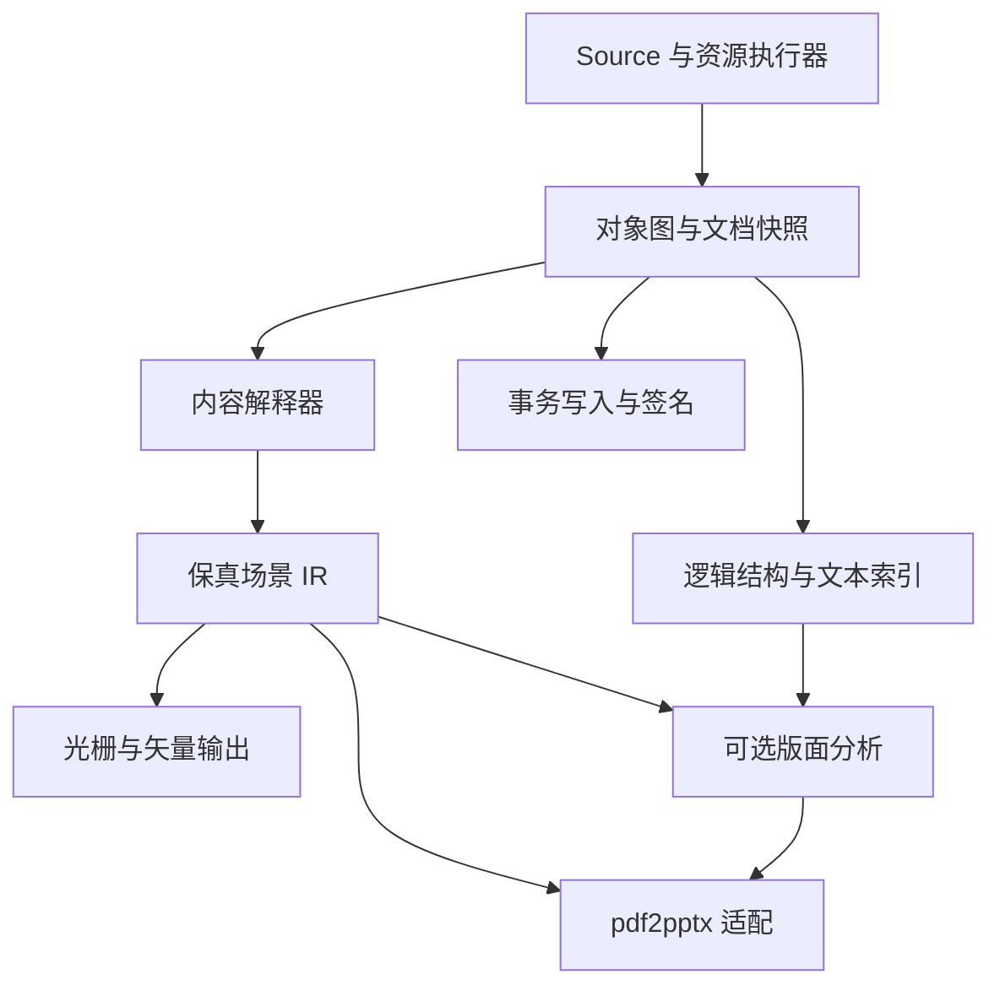

# go-pdf V1.6：架构评审与全面超越 Poppler 强化设计

日期：2026-10-21  
评审基线：《go-pdf 组件完整设计方案 V1.5.md》，共 1,474 行。  
文档性质：对 V1.5 的评审、修正规则和目标架构增补；不是现有实现验证报告，也不替代 V1.5 中未被本文修订的全部细节。本文规则与 V1.5 冲突时，以本文为建议的新基线。所有性能、兼容率和质量数值均为拟议验收目标，尚无代码与实测支持。

## 1. 评审结论

V1.5 已有扎实的工程骨架：读取与渲染分离、惰性解析、逐页能力报告、资源预算、显式降级、金样与 fuzz、下游契约测试，方向应保留。但目前更准确的定位是“面向 PDF 转 PPTX 与服务端页面图的 Go PDF 引擎”，尚不足以支撑“全面超越 Poppler”。

关键原因有三类：第一，功能边界仍排除了 Poppler 已有的部分工具、表单、注释、签名和保存能力；第二，生产渲染需要的信息尚未完整进入显示列表，增加渲染接口无法补回解释时丢失的语义；第三，若干指标和接口无法按现文兑现，包括页级并行推导每核 2 倍吞吐、累计解码量代表峰值内存、第三方实现含 internal 参数的接口等。

建议把目标调整为：**以纯 Go 内核提供可独立部署、可追溯、资源受控的 PDF 读取、渲染、提取、文档操作与交互处理能力；在冻结的 Poppler 功能基线上无未解释的产品能力缺口，在关键场景的质量、吞吐、资源效率和开发体验上取得可复现优势。**

“全面”必须对应版本、构建选项、平台、功能、测试语料和参数。不能把目标语料 0 回退等同于任意 PDF 全支持，也不能用纯 Go、静态构建或商业许可路线推导质量和速度领先。

## 2. 六个维度的评审

| 维度 | V1.5 已有优点 | 主要缺口 | V1.6 建议 |
| --- | --- | --- | --- |
| 技术 | 层次清楚，统一坐标，显式诊断 | IR 保真不足；字体与色彩接口过薄；修复算法过于启发式 | 保真场景 IR、资源图、任务式执行器、规范核对门禁 |
| 功能 | 解析、图像、文字、区域/整页渲染覆盖主线 | 表单外观、注释、签名、文件操作、多格式输出不足 | 建立 Poppler 功能基线与扩展产品包 |
| 性能 | 流式、缓存、页面并发、benchstat | 每核倍率缺依据；内存模型不闭合；双重并发可能超额 | 质量对齐基准、活跃内存令牌、统一调度与背压 |
| 解耦 | go-pdf 与 go-pptx 独立，渲染可选 | internal 插件接口不可外用；核心契约偏 PPT；全局注册隐患 | 公共扩展 SPI，实例级依赖，通用 IR 与转换适配分离 |
| 质量 | 金样、fuzz、能力矩阵、视觉指标 | 单引擎预言机；SSIM 掩盖缺陷；sfnt 安全假设不足 | 规范样本、多引擎差分、关键内容零遗漏、独立隐藏集 |
| 易用性 | 根包 API、CLI、错误码 | 普通用户需拼装多组件；布尔零值歧义；生命周期未闭合 | 一步可用预设、构建时诊断、显式策略与所有权规则 |

不对文档给出虚构的成熟度分数。实现成熟度应由编译、样本覆盖、缺陷、基准和下游验证共同确定。

## 3. 必须优先修正的问题

| 级别 | V1.5 位置 | 问题 | 必须执行的修正 |
| --- | --- | --- | --- |
| P0 | §10、§12.7 | Alpha 单值、Blend 字符串和普通 Group 无法完整承载填充/描边透明度、组混合空间、隔离、挖空、软蒙版等 | 增加完整 GraphicsState 与不可丢弃的合成节点，禁止先扁平化后补语义 |
| P0 | §9.3 | ExternalDecoder 位于 internal 且参数引用 internal/budget，外部 module 无法正常实现该契约 | 全部插件签名只使用公共稳定类型；添加仓库外消费者编译测试 |
| P0 | §8、§12.5 | 字符到 Unicode 与字形绘制路线未彻底分开 | 建立 Code→CID→GID→Outline 与 Code/MarkedContent→Unicode 两条链 |
| P0 | §8.5 | Type3 输出成 Path，不能表达含图片、图案、颜色与嵌套绘制的字形 | Type3 使用字形子场景；文字索引与绘制实体关联，避免重复绘制 |
| P0 | §12.6、§12.9 | 解码时统一转 sRGB，可能在透明组混合前丢失源色彩语义 | 解码保留样本和颜色空间；在规定的混合空间内合成，最终才转换输出 |
| P0 | §15–16 | MaxTotalDecoded 被用作内存水位，累计工作量与活跃内存混淆 | 分离累计工作预算、可释放的活跃字节预算、缓存预算和进程 RSS 观测 |
| P0 | §17.4 | “靠页级并行兑现每核吞吐 2×”没有逻辑依据 | 每核吞吐独立实测；并行只能作为实现手段，不能作为倍率证明 |
| P0 | §11、§12.4 | 不展开注释外观、不渲染表单控件，与正式页面输出冲突 | 支持 AP 外观与 Widget；缺失 AP 时按受支持规则生成，否则明确失败 |
| P0 | §4.2–4.4 | 先展开加密对象流再建解密器、同编号取最后对象、扫描 obj 文本均有歧义 | 先建立安全处理器再解密对象流；按 revision/对象号/世代/free 状态解析；修复候选进行词法与图一致性验证 |
| P1 | §6.3、§12.3 | 默认丢弃隐藏图层后，渲染 Layers 选项无法恢复 | 场景保留可选内容表达式；按 View/Print/Export 与用户配置选择可见性 |
| P1 | §12.3 | Exclude 任意节点可能破坏软蒙版、混合背景和组隔离 | 计算合成依赖闭包；拒绝无法保真的排除，或显式选择重合成策略 |
| P1 | §12.7 | 把 Multiply 当成 Porter-Duff 运算 | 分离 PDF 混合函数、透明组语义与 alpha 合成运算；建立独立测试 |
| P1 | §9.5 | 相邻色标 ΔE≤2 不能证明插值误差≤2；64 色标不是二维网格通用方案 | 输出测量方式与误差状态；网格使用空间细分，不能套用色标上限 |
| P1 | §12.1 | 空格阈值公式的 wordSpace 含义与量纲不清；为零可能失效 | 使用同坐标空间的投影间距与参考空格宽度，配合方向/语言策略 |
| P1 | §13 | 示例在检查 err 前 defer page.Close，错误路径可能空指针 | 所有 SDK 示例作为编译与运行用例；资源只在创建成功后关闭 |
| P1 | §13、§21 | “render 包独立版本”与单 Go module 发布不一致 | 单 module 统一版本，IR schema/profile 独立版本；需要独立发布时才拆子 module |
| P1 | §17.5 | 合并单元格识别指标属于上层语义恢复 | 核心只验线条/字形/结构线索；表格识别归 layout 或 pdf2pptx 集成测试 |
| P1 | 附录 C、§5.5 | 规范条款和密码处理仍按记忆描述 | 对照取得的正式规范/勘误核对并生成可追溯任务；未核实条款不得直接实现 |

### 3.1 字体方面的额外修正

`x/image/font/sfnt` 是 TTF/OTF 低层解码器，不是 PDF 全字体引擎。裸 Type1、裸 CFF、CID 映射、Type3 子场景需要明确实现与测试，不能仅凭使用 sfnt 宣称覆盖。其官方文档还明确说明未针对恶意输入加固，因此必须在字体表和轮廓读取外增加长度、操作量、递归、坐标和内存检查，建立独立 fuzz；不能把依赖白名单视为安全证明。[S3]

已嵌入、已定位的 PDF 字形通常应按原 GID 与位置绘制，不应重新 shaping。复杂文字 shaping 主要用于缺字体替代、表单 AP 生成、编辑和重新排版，需在这些路径单独设计。无法可靠恢复 Unicode 时，也可能仍可准确渲染原嵌入字形；无法恢复原 GID 时，Unicode 正确也不保证图形保真。

ActualText 是内容范围的替代文字，不一定与字形一一对应。保留原 GlyphRun，同时输出 TextSpan 与多对多字形映射；不得把一段 ActualText 重复填入每个 Glyph.Text。

## 4. Poppler 对标边界

截至核查日，官方发布页列出了 Poppler 26.10.0。该版新增 CAdES-B 签名支持和 Brotli 流支持，并记录 Form 渲染等修复。建议以此版本作为初始候选基线，落地时冻结二进制、构建依赖与选项；本次未运行该版本。[S1]

Poppler 不能简化成 pdftoppm。官方工具目录与 API 包含提取、格式转换、附件、页面拆合、表单、签名和保存等能力。具体行为还随前端、后端与构建参数变化。以下是需要测试的对标范围，不是声称 Poppler 支持所有 PDF 特性。[S2][S4]

| 能力领域 | 对标对象 | V1.6 目标与验收重点 |
| --- | --- | --- |
| 页面栅格 | pdftoppm、pdftocairo | PNG/JPEG/TIFF/PPM 等发布清单明确；文字、裁剪、透明、注释、表单及色彩正确 |
| 矢量与打印输出 | pdftocairo、pdftops | SVG/PDF/PS/EPS 按具体模式对标；混合矢量与局部栅格策略明确 |
| 文本 | pdftotext、文本 API | 普通、物理布局、坐标、搜索、选择；多栏/双向/竖排与链接关联 |
| HTML | pdftohtml | 固定版式 HTML 与可访问文本视图分别验收，外部资源自包含选项 |
| 图片和字体 | pdfimages、pdffonts | 原生码流、蒙版、JPX/JBIG2、字体清单、来源与替代信息 |
| 文档与附件 | pdfinfo、pdfdetach、pdfattach | 元数据、页面框、大纲、附件读取与添加；文件名及权限受控 |
| 页面操作 | pdfseparate、pdfunite | 拆分、合并、页面选择；资源重编号、目标引用与结构更新 |
| 表单与注释 | 前端 API 与页面呈现 | 读写、选择、字段值、AP 更新、保存和渲染；各子类型分项声明 |
| 签名 | pdfsig、签名 API | 签名字节验证、证书链与信任状态、签署能力；所需后端单独声明 |
| 兼容长尾 | 解码/字体/加密/可选内容 | 逐特性和组合测试，不能只依靠页级成功率 |
| SDK 能力 | C++/GLib/Qt 等选定接口子集 | 冻结产品需要的接口清单；Go API 实现功能等价，不要求 ABI 等价 |

### 4.1 “全面超越”的四层证据

1. **功能覆盖**：冻结范围内每项都有对应 API/CLI、测试与限制说明。缺项时报告覆盖缺口。
2. **质量不倒退**：同字体、相同页面可见性、DPI、颜色和注释策略下，关键内容无静默缺失，问题分层统计。
3. **性能优势**：在质量达标条件下分别比较 CPU 时间、端到端延迟、吞吐、峰值 RSS 与输出大小。
4. **新增价值**：保真 IR、结构化提取、增量/区域计算、资源可追溯、纯 Go 可部署包和更低接入成本。

按功能组、平台和场景发布成绩单。只有声明范围内无功能缺口、质量达标且预注册的性能与易用性目标通过，才可作限定范围的“超越”声明。未知输入全覆盖、所有工作负载都更快，均不应承诺。

## 5. 强化后的总体架构

### 5.1 三种模型各司其职

**对象图/文档快照**：保留 PDF 对象、revision、资源与逻辑引用，支撑读取、修改、保存与签名。禁止要求从显示列表反向恢复 PDF 才能编辑。

**保真场景 IR**：完整保存绘制、颜色、合成、裁剪、图层与字形关系，支撑渲染、矢量输出和转换。它是图形消费者的核心契约，但不再是附件、表单、签名等所有能力的唯一入口。

**结构与文本模型**：保存 ActualText、Tagged 结构、字符/字形映射、词行与阅读顺序。版面分析属于可选包；核心不依赖 PPTX，也不依赖 OCR/LLM。

### 5.2 依赖与模块

建议初期采用单仓库、单 Go module；仅当依赖、许可或发布节奏确需独立时才拆 module。纯 Go 核心保持可单独构建，默认产品包提供经过验证的解码、字体和色彩能力。

| 公共包 | 职责 | 不得依赖 |
| --- | --- | --- |
| pdf | 文档生命周期、页面、资源、只读视图 | render、layout、pdf2pptx |
| scene | 保真 IR 与资源引用 | pdf 根包实现、PPTX 类型 |
| text | 文本映射、搜索、选择、几何词行 | render、OCR 模型 |
| render | 栅格与区域输出 | pdf2pptx、写入事务 |
| export | SVG/HTML/打印输出适配 | 下游业务 |
| layout | 可选阅读顺序、块、表格 | pdf2pptx；允许模型适配但不强依赖 |
| edit | 文档事务、表单/注释/页面/附件操作 | render 的实现细节 |
| signature | 签名验证、签署、信任策略 | 默认网络访问、平台密钥具体实现 |
| extension | Font/Codec/Color/Key 等公共 SPI | 所有 internal 类型 |

内部保留 syntax/filter/security/document/interpreter/font/color/image/composite/raster/budget/cache。将 V1.5 根目录 raster 实现移入 internal，避免意外成为长期公共契约。公共类型只在一个中立包定义，避免 pdf↔render 循环导入。

### 5.3 依赖策略修订

“只允许标准库和 x/*”应从不可变产品约束调整为**核心依赖最小化原则**。新增依赖仍需记录许可、维护状态、纯 Go/CGO、体积、资源限制和替代方案，但经批准的 MIT/BSD/Apache 纯 Go 依赖可进入官方扩展包。否则 JBIG2、JPEG2000、ICC、字体、CMS 等能力会被迫全部自研，反而扩大维护与漏洞面。

若继续坚持绝对白名单，必须把这些能力作为正式自研工作包，并在通过前明确标记 Native Complete 尚未实现；不能同时保留外部解码缺口又宣称完整纯 Go 替代。

## 6. 保真 IR：生产渲染的前置条件

### 6.1 场景必须保存的语义

| 对象 | 必要字段/关系 |
| --- | --- |
| GraphicsState | CTM、StrokeAlpha、FillAlpha、BlendMode、RenderingIntent、Overprint/OPM、SoftMask、StrokeStyle |
| Clip | 前驱 ClipID、PathID、FillRule；包含文字裁剪的几何表达 |
| Group | BBox、Matrix、BlendColorSpace、Isolated、Knockout、子节点、资源范围 |
| SoftMask | Alpha/Luminosity、组引用、Backdrop、TransferFunction、矩阵与裁剪语义 |
| GlyphRun | FontResourceID、原 Code/CID/GID、位置与完整变换、原始文本状态、绘制模式 |
| TextSpan | Unicode、来源、置信状态、范围到字形的多对多映射 |
| Image | 编码链、解码参数、样本位深、原颜色空间、Decode、Mask/SMask、Matte、插值 |
| Paint | 原始颜色空间与分量、Pattern/Function/Shading 资源引用；sRGB 仅作派生缓存 |
| OptionalContent | OCG/OCMD 标识与可见性表达式，View/Print/Export 配置 |
| SourceRef | 文档版本、对象号/世代、内容流、操作符序号、Form 调用栈、结构上下文 |

Form 默认可复用为资源子图；与透明组不同的语义必须分开表达。即使调用方选择展开 Form，也不得丢掉透明组边界。图资源共享保持不可变，递归循环在构图阶段拒绝。

### 6.2 坐标、精度与 Bounds

保留 V1.5 左上原点、pt、Rotate/UserUnit 已应用的消费者视图；同时保存原 PDF 空间与变换。描边必须保留原路径及其 CTM，不能在非均匀缩放/剪切后仅给一个页面空间线宽。区分 GeometryBounds、InkBounds、VisibleBounds；边界允许保守估计并携带状态，不能把近似包围盒用于精确裁剪。

数值限制覆盖 NaN/Inf、奇异矩阵、极端缩放与坐标溢出。Sig 可用于重复检测提示，但去重/缓存必须结合强摘要或内容核验，不能把 uint64 相等当作等价证明。

### 6.3 流式、快照与版本

Walk 提供 BeginGroup/EndGroup 或结构等价的事件，引用必须可解析；物化场景与流式事件经标准化后语义一致。回调借用缓冲的有效期必须显式规定，提供 Copy/Retain 路径。图像与字体资源拥有 Close 或文档绑定生命周期，禁止池缓冲提前复用。

IR 序列化采用类型标签和固定 schema，替换 Geometry any 等不可稳定编码字段。新语义无法无损映射到旧 IR 时升级 major；不能通过“只增加字段”声称旧消费者仍然语义兼容。保留旧版投影视图，但标记丢失的能力。金样用规范化编码和语义断言，不能只用全对象 JSON 哈希判断兼容。

## 7. 原生完整能力包

### 7.1 产品预设

| 预设 | 目标 | 依赖与失败行为 |
| --- | --- | --- |
| Minimal | 对象读取、文字和资源提取 | 最小依赖；不伪装具备完整渲染 |
| Native Screen | 常用文档的纯 Go 屏幕渲染 | 官方已验证字体/颜色/解码组合，缺关键能力明确拒绝 |
| Native Complete | 冻结 Poppler 功能基线的完整纯 Go 产品 | JBIG2/JPX 等必需能力全部就绪且验证后才允许使用该名称 |
| Extended | 可选平台密钥、外部字体/OCR/模型/回退引擎 | 每个外部依赖可查询；不计入纯 Go 自主能力覆盖 |

这些是链接与配置组合，不是复制多套内核。Preview 与 Production 使用同一解释、合成和光栅实现，通过质量与预算策略区分；不维护两套长期分叉的渲染器。

### 7.2 解码

把 CCITT、JBIG2（含全局字典和组合段）、JPEG2000/JPX（含 PDF 使用到的位深、组件、alpha/颜色映射）纳入 Native Complete 正式范围。支持情况按码流特性声明，不能只写“支持 JPX”。标准库 JPEG 之外的变体先做差异语料，再决定补充实现。

V1.5 的 []byte 全码流接口改为 ReaderAt/长度或有界 Reader；在分配前读取受限头信息并计算资源需求。解码结果返回原始样本平面、颜色空间和 mask 语义，显示转换由颜色管线处理。JBIG2 全局资源计入文档缓存，避免逐页重复解码。

Brotli 等新增基线特性先核对 Poppler 的具体语义、规范入口与配置，再列入兼容任务；发布日志提到支持不等于所有 Brotli 文件形式都属于本项目必须实现的 PDF 标准能力。[S1]

### 7.3 色彩与合成

ColorManager 从逐像素 ToSRGB 升级为“创建可复用颜色变换→批量转换”。输入包含源/目标 ICC、渲染意图、输出意图、黑点补偿策略和精度；变换按内容摘要缓存，处理 ICC 损坏、unsupported tag 与 LUT 预算。

支持设备空间、Cal/Lab/Indexed、ICCBased、Separation/DeviceN 及规范函数；保留原始样本直到所需颜色运算完成。透明组在其正确混合空间内执行，Luminosity 软蒙版不能从任意 sRGB 灰度近似替代。单独覆盖 Mask/SMask、Matte 去底色、文字剪裁、隔离/挖空组、所有适用 PDF 混合模式。

屏幕 sRGB 与印刷分色/叠印设不同质量配置。屏幕模式不等于印刷颜色正确；若声明覆盖打印输出，必须加入专色、OP/OPM、转移函数/半色调等适用能力与色彩验收。自研光栅无法处理的图案，不能把“区域栅格”写成解决方案：区域渲染使用的仍是同一引擎，必须真正实现或报告缺口。

### 7.4 字体与替代

实现完整的 PDF 字体解析适配层，覆盖 Type1 CharStrings、CFF/CID、TrueType、Type3 子场景、竖排与适用的标准编码。字体替代按字形覆盖和度量匹配，不只按 family 名称匹配；以 cluster 为单位处理复杂脚本，保持 PDF 原定位优先。

FontProvider 应是不可变解析服务，返回字体摘要、来源、覆盖与替代原因。SystemFonts 发现独立为可选系统适配，Missing 是单次任务结果，不能成为并发共享 Provider 的可变全局状态。

提供可选且许可明确的字体包或离线安装指引，以内容摘要锁定字体；库本体不强制捆绑字体。容器无字体时 NewRenderer/Preflight 即说明能力缺口，不等到成片才报缺字。替代预算按独立 face/cluster 和工作量计数，不能因为一页超过 64 个汉字发生回退就判超限。

### 7.5 注释、表单、图层

AnnotationPolicy 显式设置 None/View/Print；Widget 支持字段树、继承属性、值与外观状态。优先渲染已有 AP，缺失或无效时用表单专用布局生成 AP；修改字段后同步更新外观与保存结果。链接热区与可视外观独立。

OCG/OCMD 支持成员策略、表达式与用途配置。隐藏图层在共享场景中保留，仅在消费视图过滤。静态 XFA 外观与动态 XFA 分别列出支持情况，不能由 AcroForm 支持推导 XFA 支持。

默认不执行 PDF JavaScript。若冻结范围涉及动作或脚本功能，先列明对应 Poppler 前端行为与产品需求；静态呈现、动作识别和脚本执行不得混为一项。扩展执行器需显式授权，不能进入默认渲染路径。

## 8. 文档操作、输出与签名

### 8.1 写入不再“以后按需立项”

全面替代所需的页面拆合、附件添加、表单/注释保存必须成为正式产品线。采用不可变 DocumentSnapshot + EditTransaction：校验引用→构造新对象→提交到临时目标→成功发布新快照。源文件默认不原地覆盖。

拆合需处理页面引用重映射、资源共享、大纲/命名目标、表单名称冲突、Tagged 结构、页面标签、附件与加密策略。未迁移部分生成明确报告。增量保存保留旧 revision，Full Rewrite 可回收不可达对象；“隐藏/覆盖内容”不能当作安全删除。脱敏需移除图形、文本、资源和历史 revision 并检查残留。

所有修改报告签名影响。保留旧签名字节不等于修改后文档依然符合签名授权；依据修改权限和签名覆盖范围分别判断。

### 8.2 输出后端

原生输出包含像素流、PNG/JPEG/TIFF/PPM 等选定格式；矢量输出包含 SVG，打印与再封装包含 PDF/PS/EPS。每个后端维护独立能力表和降级报告。路径/文字可表达时保留矢量，复杂合成可按明确 DPI 局部栅格；对比质量与体积时把栅格策略写入参数。

HTML 区分固定版式视图与语义文本视图，输出的字体、图片、链接与附件采用可控资源目录或自包含方式；默认不从文档外部 URL 取资源。多页/多格式不是更改文件后缀，须逐格式验证解码、页数、颜色与可见内容。

### 8.3 签名

分离四个结论：签名字节完整性、证书链构建、信任策略、签名后修改状态。对 CMS/CAdES、时间戳、撤销信息、允许的增量修改建立具体支持清单；未支持算法明确报告 unknown/unsupported，不归类为文档已被篡改。

签署接口使用 crypto.Signer 风格的 KeyProvider，平台密钥、PKCS#11、云 KMS 在扩展层；CMS 等依赖同样需要纯 Go 路线与测试。默认离线，不自动联网获取证书/OCSP/CRL；可选网络由调用方策略控制。密码、token PIN、私钥材料不得进入诊断。26.10.0 的 CAdES-B 功能列为基线待测项，而非完整 PAdES 长期验证的同义词。[S1]

## 9. 公共 API 与可用性契约

### 9.1 设计规则

- 普通渲染用一个经过验证的 Bundle 预设即可创建 Renderer；高级用户才替换字体、解码和颜色服务。
- NewRenderer 进行依赖与策略校验；Preflight 输出已扫描范围和能力缺口，不能在未遍历资源时给出“全页支持”。
- 布尔开关改为枚举/策略：TextDefault/Include/Exclude、AnnotationsView/Print/None、BackgroundWhite/Transparent；DPI 与显式像素尺寸冲突时返回参数错误。
- Layers 使用稳定 OCG ID，不能只用可能重复的名称；Exclude 用场景选择器和依赖闭包，避免任意回调破坏合成与确定性。
- 提供 RenderImage 与 EncodeTo 两步 API，区分渲染与编码成本；大输出支持有界写入与原子文件提交。
- 外部扩展只用公共类型，实例级注册，构造后 registry 不可变；禁止全局注册影响测试与并发任务。

### 9.2 生命周期

Document 关闭先拒绝新任务，再取消或等待活跃任务，策略在打开时确定。资源借用不能超过文档生命周期；需要跨任务缓存时提供 Detach/Copy 并重新计预算。Renderer 可并发；task 持有独立诊断、取消和分配租约；可变 decoder 必须每任务实例化或经接口明确并发约束。

ReaderAt 打开接口必须接受 size；io.Reader 只有在允许受预算落盘/缓存后才能提供随机访问，不能宣称所有 PDF 都可单遍流读。自定义 ReaderAt 和第三方 decoder 若不配合取消，context 不能强制中断其阻塞；硬截止时间由隔离 worker 进程负责。

### 9.3 错误和能力状态

能力按 Parse/Extract/Render/Edit/Export/Verify 分开报告，增加 Unknown、NotScanned、NotApplicable。区分 Supported/Approximate/Unsupported 与执行 Outcome：Success/Partial/Failed。因预算超限失败不能伪装成“不支持此 PDF 特性”。

报告包含 RequestedProfile、EffectiveProfile、插件及资源摘要、近似项、失败原因与覆盖范围。RenderFull 表示在指定配置内能力齐备，不是像素等同于 Acrobat，也不是签名/可访问性/打印合规证明。

CLI 默认可读输出，--json/--jsonl 用稳定 schema；页码对用户采用 1 起始，SDK 保持 0 起始并显式转换。批量任务有进度、逐页结果、可重试列表、失败原子性。默认密码不通过命令行参数暴露，支持受控输入。设置固定退出码映射并测试每类结果。

## 10. 性能与资源：可兑现的设计

### 10.1 四种预算分离

| 预算 | 累计/水位 | 说明 |
| --- | --- | --- |
| WorkBudget | 累计，不归还 | 解码累计字节、操作符、函数步数、路径段、递归工作 |
| LiveMemory | 活跃，可释放 | 对象、位图、组缓冲、临时采样、编码缓冲的分配租约 |
| CacheBudget | 活跃，可驱逐 | 对象/字体/ICC/图像/场景缓存；固定总额与 pin 计数 |
| ProcessEnvelope | 进程观测/隔离 | Go runtime、栈、未计量分配和 RSS；用容器/worker 提供硬隔离 |

每个任务开始时预留必要内存，超额则排队、减并发或受控失败；不能先分配后计账。分配成功才获得 lease，释放/驱逐归还。磁盘 spool 独立配额与清理规则。`GOMEMLIMIT` 只能作为辅助运行时配置，不是 RSS 硬上限。

64 Mpx 的 RGBA 输出本身约 256 MB（约 244 MiB），双缓冲已接近 512 MB，尚未计软蒙版、隔离组、解码图片和编码开销。最大像素不能独立决定安全并发。

### 10.2 全局调度与背压

建立 Executor，统一限制页任务、tile、解码任务和编码任务；页级与页内并发共用令牌，避免各自 GOMAXPROCS 导致超额。并发数取 CPU 预算与内存预算可容纳任务数的较小者。普通页页级并发，超大页经计划器启用 tile，调用方可禁止后台协程。

流水线队列有固定容量；消费者变慢时停止上游预取。取消一个页面不取消整份文档的其他独立任务，取消文档则传播全部任务。共享资源加载去重，缓存键包含输入内容、revision、参数、解码器与颜色/字体摘要；禁止仅用对象编号跨文档命中。

### 10.3 tile 的正确性

使用空间索引检索相交绘制实体，避免每块遍历所有节点。抗锯齿、插值和描边使用足够 halo；透明组、软蒙版和图案按正确全局坐标执行。不得把非隔离组简单作为互不相关 tile 绘制；必要时共享受预算的组表面或使用条带。回归验证整页与分块在同一算法配置下的等价性。

输出 PNG 仍可能需要整页缓冲或特定流式编码实现；不能因为采用 tile 就宣称峰值仅一个 tile。内存公式至少包括共享源图、活跃 tile、组/mask、缓存、输出缓冲与编码缓冲。

### 10.4 基准协议与拟议门槛

先冻结质量再比速度。Poppler Splash 与 Cairo 两条路径分别记录；不混用其中最快结果却省略后端名称。进程启动的冷路径与复用进程/文档缓存的热路径分开；CLI 对 CLI、库对库或清楚标记不可完全对等。

冻结机器、CPU 配额、内存、OS、Go/编译选项、Poppler 依赖、字体、ICC、语料摘要、DPI/像素、注释/图层、抗锯齿、输出编码和线程数。固定墙钟预算同时报告 CPU 时间、单核与多核吞吐、P50/P95/P99、RSS 和编码时间，失败页不作为“更快”的成功数据。

| 指标 | 替代门槛建议 | 超越目标建议 |
| --- | --- | --- |
| 热路径页级 P95 | ≤ 基线 1.10× | ≤ 基线 0.80× |
| 同配额端到端吞吐 | ≥ 基线 1.00× | ≥ 基线 1.30× |
| CPU 秒/页 | ≤ 基线 1.10× | ≤ 基线 0.85× |
| 峰值 RSS | ≤ 基线 1.10× 且不超配置 | ≤ 基线 0.80× |
| ROI/重复页任务 | 独立输出正确性通过 | 固定业务集 ≥ 2× 加速 |
| 性能回归 | 稳定 runner 多轮统计显著且劣化 >5% 阻断 | 同左，质量改善导致的代价走明确决策 |

这些是需要基准校准的研发目标，不是现有数据，也不要求所有 workload 同时达到每个倍率。全面性能领先必须预先定义逐分层门槛并全部通过，不能只给有利平均值。页/秒/核统一除以分配的核数；页级并行本身不证明每核效率提高。

## 11. 质量体系与验证门槛

### 11.1 三层证据

**规范构造样本**：逐操作符、字体、加密、颜色、图层、表单和签名小样本，提供可手算期望值。对已核对的规范条款建立 sample→assertion→implementation 追踪。

**多引擎差分**：Poppler 主基线，PDFium 等独立引擎交叉验证。引擎不一致时进入人工/规范裁决，不能把参考引擎输出绝对化。测试环境与生产依赖分别管理，保留工具许可与资源来源记录。

**真实与隐藏集**：按生成器、语言、字体、图像编码、颜色/透明组合分层；训练/调参语料与发布隐藏集按文档家族去重分开。中文 Office 文档是重点，不能据此替代日韩、竖排、阿拉伯/印度系和科学公式验证。

### 11.2 拟议质量门槛

| 领域 | 门槛设计 |
| --- | --- |
| 关键内容 | 已知金样中静默漏字、缺图、遮盖错误、图层误显、AP 丢失为 0 |
| 视觉 | SSIM 作为筛查，拟议 ≥0.99；按类别和最差页报告，不独立决定通过 |
| 文本 | 同时报告字符精确率/召回率、CER、顺序错误、ActualText 重复；关键标注语料要求完全正确 |
| 几何 | 字形/路径 P95 延续 ≤0.3 pt 初值，另设最大值与关键区域门槛；保守 Bounds 不混入真值 |
| 色彩 | ΔE2000 对规定色卡与有效像素统计；P95≤3 作为初值；排除背景掩盖效应并检验最坏区域 |
| 透明 | 独立 alpha 金样 PSNR≥45 dB 初值，加颜色合成与边缘测试；不从最终不透明 PNG 反推 alpha |
| 可靠性 | 无未处理 panic；正常任务无数据竞争、泄漏、死锁；故障注入有明确结果 |
| 取消 | 协作式任务在声明检查粒度内退出；第三方不合作路径单列，隔离 worker 可强制终止 |
| 写入 | 输出重新打开、跨引擎读取、对象引用和表单/注释外观一致；签名影响报告准确 |
| 能力报告 | 不支持和近似预测命中率及漏报率分别统计；完整扫描前不得误报 full |

小字号、上标、负号、小数点、公式、签章、透明水印和金额必须有局部差异检查。全页 SSIM 很高仍可能把“100.0”读成“1000”；全局平均指标不能替代关键内容门禁。

### 11.3 安全与确定性

recover 只能把可恢复的 panic 转换为错误，不能可靠拦截 OOM、无限 CPU 或任意阻塞；文档应删除“单页失败绝不会拖垮整批”的无条件保证。纯 Go 默认库路径提供预算和协作取消，高风险批量输入可选择同版本 CLI worker 隔离，仍可保持无 CGO。

fuzz 覆盖词法、xref、过滤器、图片、CMap、字体轮廓、函数、ICC、合成、写入与签名解析；对差分发现异常自动最小化。预算、工作量和分配路径要故障注入，不能只跑正常数据。资源上限即使 Repair 也不得放宽。

确定性分级：同构建/架构/资源集要求像素一致；跨架构先用误差界与专门验证，只有受控数学路径通过后才承诺跨平台 bit-exact。Profile 摘要包含引擎构建、插件、字体文件、ICC、浮点/AA、可见性与渲染参数。PNG 文件哈希与像素哈希分开。

### 11.4 回退率与退役条件

同时统计：能力不支持率、执行失败率、显式回退率、静默错误率、整文档失败率。分母必须包含所有符合输入合同的请求，不能移除失败页美化结果。

回退率 0 只证明固定测试/观察范围无回退。建议验收至少包含独立保留集和生产观察期，报告样本量；若 n 个近似独立样本零失败，95% 单侧失败率上界可粗略用 3/n 估计，文档内页面相关时必须按文档聚类或采用更保守方法，不能直接把每页当独立样本。

Native Complete 退役 Poppler 的前提：冻结功能表无未交付项、关键回归通过、目标业务隐藏集无回退、线上问题可重放、性能符合替代门槛、故障可切换到上一自有版本。保留“Extended 可选外部引擎”不影响内核独立，但外部引擎救回的页面不计作原生成功。

## 12. 阅读与版面能力：形成差异优势

保留核心几何提取，同时提供可选 layout 包，避免每个下游重复实现多栏、段落、表格和阅读顺序。layout 输入 scene+text+结构树，输出语义块、来源、置信状态和候选关系，不修改底层绘制事实。

文本功能至少包括字符/词/行、搜索与高亮 quad、选区提取、双向与竖排、Tagged 优先阅读顺序、无标签几何回退、OCR 文本层去重。对 Unicode 正规化、连字展开、不可见文字与隐藏图层采用显式选项。

扫描识别从 Page.Scanned bool 升级为 Native/Scanned/Hybrid/Unknown 与证据：图像覆盖率、可见文字数量、隐藏 OCR 层、置信度。整页图片也可能是设计背景，不能自动判定为扫描文档。

OCR、模型表格识别和 LLM 仍留在扩展层；结果必须携带模型/参数、来源与坐标回映，不能与精确解析事实混为一类。pdf2pptx 保留对 PPTX 编辑性、重排与 OOXML 兼容的最终决策权。

## 13. 开发工作包与依赖门禁

下表是工程依赖次序，不是通过分期缩减最终能力。冻结的最终范围必须持续保留，阶段通过不等于全面完成。

| 工作包 | 交付 | 前置 | 完成证据 |
| --- | --- | --- | --- |
| BASE-01 | Poppler 冻结基线、规范核对表、语料清单 | 无 | 二进制/构建/资源/语料摘要可复现 |
| API-01 | 公共 SPI、生命周期与错误状态 | BASE-01 | 外部 module 示例编译与并发/关闭测试 |
| IR-02 | 保真 IR、文本双轨、资源快照 | API-01 | 组/mask/Type3/图层语义金样通过 |
| CORE-02 | revision/xref/加密/修复正确性 | BASE-01 | 加密对象流、free/世代、重建歧义用例通过 |
| RES-02 | 活跃内存租约、共享缓存、Executor | API-01 | 预算故障、取消、背压与 RSS 报告 |
| FNT-06 | PDF 全字体适配与替代 | IR-02、RES-02 | Code/CID/GID 与复杂文本/Type3 独立验证 |
| IMG-03 | JBIG2、JPX 原生能力 | API-01、RES-02 | 子特性和异常码流覆盖报告 |
| CLR-02 | ICC 变换与 PDF 混合空间 | IR-02、RES-02 | 色卡、组/mask/专色对照通过 |
| RND-10 | 单一光栅内核、ROI、tile、计划器 | IR-02、FNT-06、IMG-03、CLR-02 | 整页/分块、关键区域、资源测试通过 |
| FORM-01 | 注释与 Widget 呈现/编辑 | IR-02、FNT-06 | AP 存在/缺失/更新、保存后视觉通过 |
| TXT-02 | 文本索引、选择、阅读顺序 | IR-02 | Unicode、顺序、ActualText、语言专项指标 |
| WRT-01 | 事务保存、拆合、附件与页面操作 | CORE-02、RES-02 | 重新打开、引用与跨引擎一致性 |
| SIG-01 | 验证/签署与 KeyProvider | WRT-01 | 已知签名、修改、时间戳、信任结果分项验证 |
| OUT-01 | SVG/HTML/打印/图像输出 | RND-10、TXT-02 | 每后端能力、降级、文件合法性报告 |
| PERF-03 | 基准与优化 | 质量达标工作包 | 配对重复实验与各分层原始数据 |
| REL-01 | Native Complete 发布资格 | 全部必需工作包 | 功能覆盖表、质量、资源、性能与兼容报告 |

G0 冻结完整 IR 的原规则建议取消：语法层完成时只能冻结实验性 v0 schema，待透明组、Type3、色彩与至少两个消费者验证后再发布稳定 major。否则“契约稳定”会把早期信息缺失固化。

## 14. V1.5 逐章修订指引

| 章节 | 处理 |
| --- | --- |
| 1 | 扩展为通用 PDF 引擎，保留 pdf2pptx/ppts 首要场景；删除未验证的“没有现成产品覆盖”结论 |
| 2 | 拆分读取/提取/渲染/编辑/导出/签名矩阵，新增部署预设和功能基线 |
| 3 | 增加对象快照、保真 IR、文本结构、事务写入和公共 SPI |
| 4–5 | 修订修复、revision、对象流解密顺序与密码规范核对；Repair 不放宽安全上限 |
| 6–8 | 保留原坐标与可见性表达式；字体双轨；Type3 子场景；ActualText 范围映射 |
| 9–10 | 原样本与色彩/合成信息保真；完整场景 IR；稳定资源与序列化契约 |
| 11–12 | 注释/表单 AP、完整合成和原生解码正式纳入；Preview/Production 共用内核 |
| 13–14 | 预设开箱可用、生命周期、外部扩展、按任务区分状态与覆盖范围 |
| 15–16 | 活跃内存/累计工作/缓存/RSS 分离；统一调度；质量对齐基准 |
| 17 | 多引擎、隐藏集、关键内容、分层最差指标和写入/签名门槛 |
| 18–20 | 改为依赖驱动工作包，不再把写入/签名留作无期限按需项 |
| 21–22 | 下游消费不同公共视图；新增拆合/附件/表单/签名/导出 CLI |
| 23–24 | 调整依赖准入、版本规则、资源与样本许可；保留官方来源 |
| 附录 A–C | 合并累积补丁，清理旧规则；规范引用完成核对后才升为实施基线 |

建议新增决策：ADR-035 保真场景与对象快照分离；036 公共 SPI；037 Native Complete 原生解码；038 字形与文字双轨；039 内存租约与统一 Executor；040 表单/写入/签名产品线；041 质量对齐性能协议；042 多维能力报告；043 同内核多预设；044 范围明确的超越声明。旧 ADR 冲突项标明 superseded，避免新旧条款并存。

## 15. 推荐决策

维持纯 Go、无 CGO 的内核方向，维持 go-pdf/go-pptx/pdf2pptx 之间的独立边界。将 Poppler 从“始终可弥补缺口的生产回退”调整为“研发对标与 Extended 可选适配”，把必需能力的自主交付纳入 Native Complete 门槛。

优先投入 IR、字体双轨、公共 SPI、内存模型和色彩/合成语义；这些决定后续能力能否正确扩展。随后按依赖图推进原生解码、表单、写入、签名与输出。性能优化以正确结果为约束，在 ROI、缓存复用、重复资源和服务端批处理形成差异优势。

最终产物应包括：组件与 CLI、能力清单、稳定 API/schema、已知限制、可重现基准、隐藏集评测报告、许可证/资源清单、下游契约报告。缺少其中的关键证据时，可以发布功能预览，但不能宣称已经全面超越 Poppler。

## 参考来源与证据范围

- [S0] 本次读取的《go-pdf 组件完整设计方案 V1.5.md》，2026-10-21 版本；本文对现设计的定位、章节与问题均据此评审。
- [S1] Poppler 官方发布记录：https://poppler.freedesktop.org/releases/ 。用于版本与新增特性核查；未据此推导全部标准覆盖和性能。
- [S2] Poppler 官方 GLib 文档：https://poppler.freedesktop.org/api/glib/PopplerDocument.html 。用于文档、表单、附件、签名字段与保存等 API 能力存在性的核查；不代表所有前端具有相同 API。
- [S3] Go 官方 sfnt 包文档：https://pkg.go.dev/golang.org/x/image/font/sfnt 。用于 TTF/OTF、资源生命周期及安全边界核查；具体版本应在实现时锁定。
- [S4] Poppler 官方源码镜像工具目录：https://cgit.freedesktop.org/poppler/poppler/tree/utils 。用于工具清单检索；本次直接展开曾超时，基线冻结时仍须逐工具核对正式版本手册、选项与依赖。

本文中接口分层、数据模型、预算、质量门槛与性能倍率均为评审建议；尚未实施、编译或运行基准。本次未审查代码仓库，不能据设计文档断言实现具备相应缺陷或能力。
